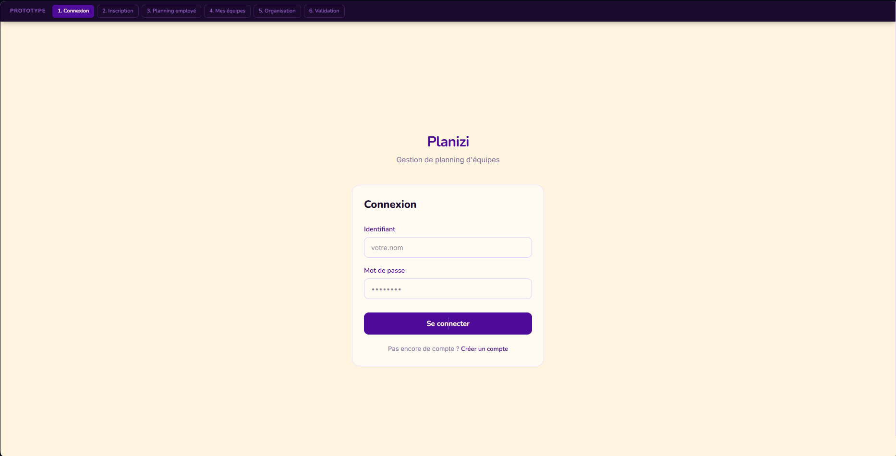
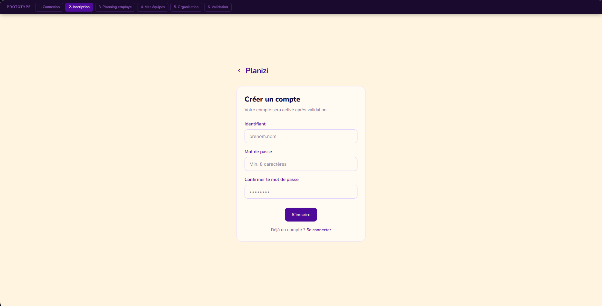
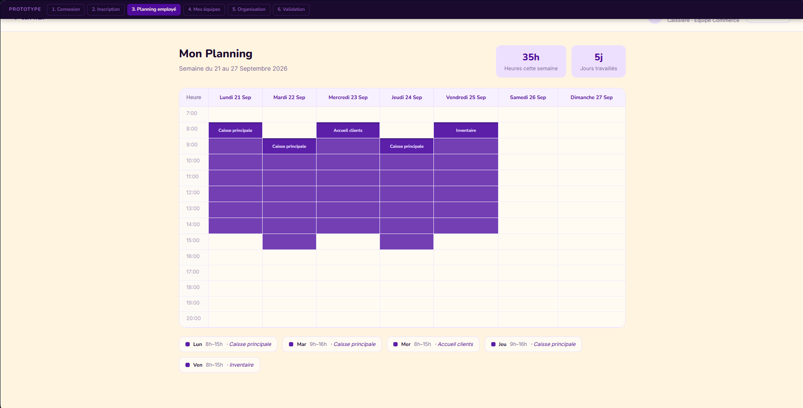
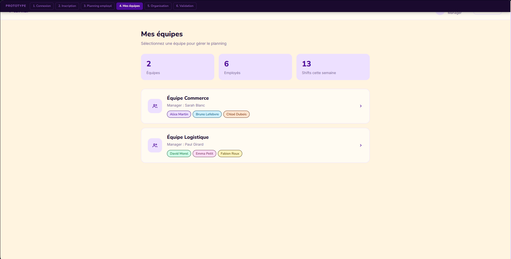
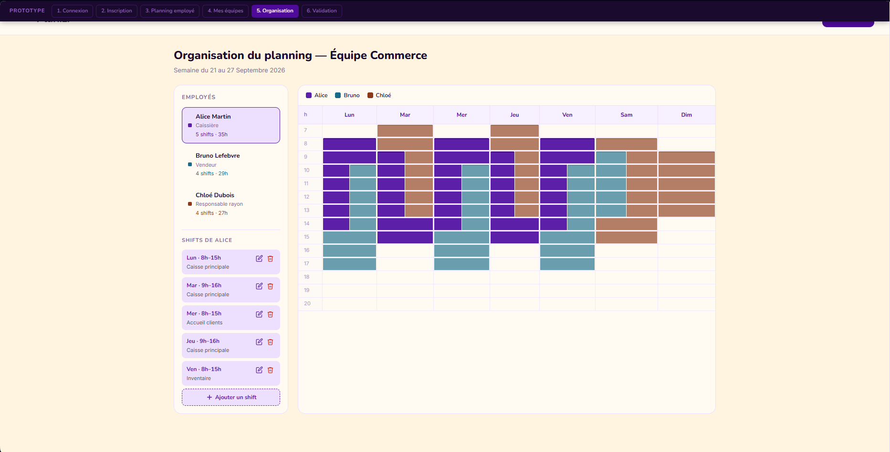
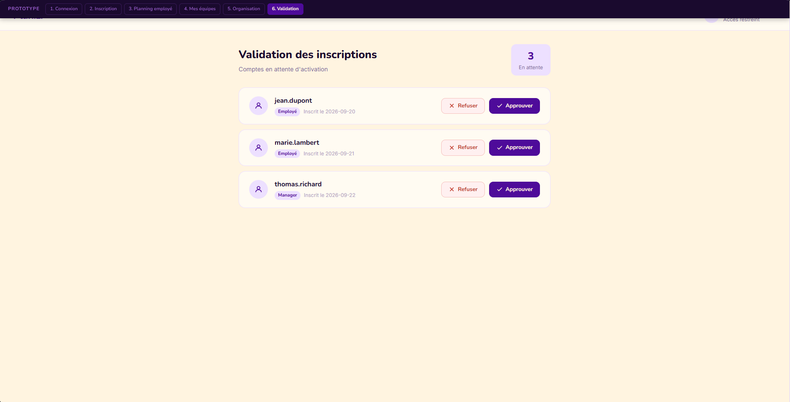

# Planizi

Application web de **gestion de plannings d'équipe**, développée en Python avec **Flask** et **PostgreSQL**.

Les employés consultent leur planning de la semaine, les managers organisent les horaires de leurs équipes et un superviseur valide les inscriptions et administre les comptes.

---

## Sommaire

- [Fonctionnalités](#fonctionnalités)
- [Rôles et écrans](#rôles-et-écrans)
- [Maquettes](#maquettes)
- [Technologies](#technologies)
- [Structure du projet](#structure-du-projet)
- [Installation](#installation)
- [Configuration (.env)](#configuration-env)
- [Base de données](#base-de-données)
- [Lancer l'application](#lancer-lapplication)
- [Déploiement avec Docker](#déploiement-avec-docker)
- [Comptes de démonstration](#comptes-de-démonstration)
- [Routes](#routes)
- [Règles métier](#règles-métier)
- [Sécurité](#sécurité)

---

## Fonctionnalités

- **Inscription** avec génération automatique d'un identifiant unique (`p.nom`, puis `p.nom2`, `p.nom3`…).
- **Validation des comptes** par un superviseur : poste, nombre d'heures du contrat et rôles (manager / superviseur).
- **Connexion / déconnexion** avec mots de passe hachés.
- **Planning personnel** sous forme de grille hebdomadaire : total d'heures, taux de remplissage du contrat, jours travaillés, légende des types de shift.
- **Gestion des équipes** par les managers : création, renommage, ajout / retrait de membres, suppression.
- **Organisation du planning d'une équipe** : ajout, modification et suppression de shifts pour tous les membres, enregistrés en une seule fois.
- **Types de shift** : `Travail`, `Formation`, `Réunion`, plus des types personnalisés créés à la volée (ex. `Astreinte`), chacun avec sa couleur.
- **Shifts de nuit** : un shift dont l'heure de fin est avant l'heure de début se termine le lendemain.
- **Administration des utilisateurs** : modification des informations, des rôles, du mot de passe, désactivation d'un compte.
- Navigation de **semaine en semaine** sur tous les plannings.

---

## Rôles et écrans

| Rôle | Page d'accueil après connexion | Accès |
|---|---|---|
| **Employé** | Écran 3 – *Mon planning* (`/planning`) | Son propre planning |
| **Manager** | Écran 4 – *Mes équipes* (`/equipes`) | Son planning, ses équipes, écran 5 (organisation) |
| **Superviseur** | Écran 6 – *Validation* (`/valider-compte`) | Validation des inscriptions, onglet *Utilisateurs* |

Un utilisateur peut cumuler plusieurs rôles. Les rôles sont relus en base à **chaque requête** : un rôle retiré ou un compte désactivé prend effet immédiatement, sans reconnexion.

---

## Maquettes

Le prototype a été réalisé avec **Figma Make** : [ouvrir le prototype sur Figma](https://www.figma.com/community/file/1691384090162897493).

| Écran 1 – Connexion | Écran 2 – Inscription |
|---|---|
|  |  |

| Écran 3 – Mon planning | Écran 4 – Mes équipes |
|---|---|
|  |  |

| Écran 5 – Organisation du planning | Écran 6 – Validation des comptes |
|---|---|
|  |  |

---

## Technologies

- **Python 3** / **Flask 3.1**
- **PostgreSQL** via `psycopg2`
- **Jinja2** pour les templates HTML
- **Werkzeug** pour le hachage des mots de passe
- **python-dotenv** pour la configuration
- HTML / CSS / JavaScript
- **Docker** / **Docker Compose** pour le déploiement : **nginx** (proxy) et **gunicorn** (serveur d'application)

---

## Structure du projet

```
Planizi/
├── app.py              # Application Flask : routes, contrôles d'accès, gestion des erreurs
├── database.py         # Connexion PostgreSQL, comptes utilisateurs (inscription, connexion, validation…)
├── planning_db.py      # Équipes, shifts, calcul des semaines, validation des plannings
├── migrer.py           # Migration du schéma (idempotente)
├── seed.py             # Réinitialisation de la base avec des données d'exemple
├── schema.sql          # Structure de la base (tables, clés, index)
├── donnees.sql         # Données de démonstration
├── requirements.txt    # Dépendances Python
├── .env                # Configuration locale (non versionné)
├── maquettes/          # Captures du prototype Figma
├── docker/             # Déploiement sur trois conteneurs (voir docker/PROCEDURE.md)
│   ├── compose.yaml        # Services, réseaux, volume, publication du port
│   ├── metier.Dockerfile   # Image de l'application (Flask + gunicorn)
│   ├── proxy.Dockerfile    # Image du proxy (nginx + fichiers statiques)
│   ├── nginx.conf          # Configuration du proxy
│   ├── *.dockerignore      # Ce qui n'entre pas dans les images
│   ├── .env.example        # Modèle de configuration
│   └── *.ps1               # Vérification de l'isolation et mesures
├── docs/               # Comparaison VM / conteneurs, matrice, relevés de mesures
├── static/             # Feuilles de style CSS
│   ├── app.css
│   ├── connexion.css
│   ├── inscription.css
│   └── validation.css
└── templates/          # Pages HTML (Jinja2)
    ├── base.html           # Gabarit commun (barre de navigation)
    ├── connexion.html
    ├── inscription.html
    ├── planning.html       # Écran 3
    ├── equipes.html        # Écran 4
    ├── organisation.html   # Écran 5
    ├── validation.html     # Écran 6
    ├── utilisateurs.html   # Écran 6 bis
    ├── erreur.html         # Pages 400 / 403 / 404
    └── index.html
```

---

## Installation

### Prérequis

- Python 3.10 ou plus récent
- Un serveur PostgreSQL (avec l'outil en ligne de commande `psql`)
- Git

### Étapes

```powershell
# 1. Cloner le dépôt
git clone https://github.com/Etha-an/Planizi.git
cd Planizi

# 2. Créer et activer un environnement virtuel
python -m venv venv
venv\Scripts\activate          # Windows
# source venv/bin/activate     # Linux / macOS

# 3. Installer les dépendances
pip install -r requirements.txt
```

---

## Configuration (.env)

Créez un fichier `.env` à la racine du projet :

```env
DB_HOST=localhost
DB_PORT=5432
DB_USER=postgres
DB_PASSWORD=votre_mot_de_passe
DB_NAME=planizi
SECRET_KEY=une_longue_chaine_aleatoire
```

| Variable | Rôle |
|---|---|
| `DB_HOST` | Adresse du serveur PostgreSQL |
| `DB_PORT` | Port PostgreSQL (5432 par défaut) |
| `DB_USER` / `DB_PASSWORD` | Identifiants PostgreSQL |
| `DB_NAME` | Nom de la base de données |
| `SECRET_KEY` | Clé de signature des cookies de session Flask |

Pour générer une `SECRET_KEY` :

```powershell
python -c "import secrets; print(secrets.token_hex(32))"
```

> Le fichier `.env` est ignoré par Git (`.gitignore`) : ne le versionnez jamais.

---

## Base de données

### Schéma

```
user                         team
├── id (PK)                  ├── id (PK)
├── nom, prenom              └── nom
├── email (UNIQUE)
├── login                    user_team  (appartenance à une équipe)
├── password_hash            ├── user_id  (FK → user)
├── poste                    ├── team_id  (FK → team)
├── contrat (heures/sem.)    └── responsable (1 = gère l'équipe, 0 = simple membre)
├── manager (0/1)
├── supervisor (0/1)         shift
└── valid (0/1)              ├── id (PK)
                             ├── categorie (Travail, Formation, Réunion, …)
                             ├── debut, fin (DATETIME)
                             ├── effectueur_id (FK → user : qui travaille)
                             └── assigneur_id  (FK → user : qui a planifié)
```

Toutes les clés étrangères sont en `ON DELETE CASCADE` : supprimer un utilisateur supprime ses shifts et ses appartenances aux équipes.

> `user` est un mot réservé en PostgreSQL : la table s'écrit toujours entre guillemets (`"user"`) dans les requêtes.

### Création de la base

1. Créez la base :

   ```powershell
   psql -U postgres -c "CREATE DATABASE planizi ENCODING 'UTF8';"
   ```

2. Créez les tables avec `schema.sql` :

   ```powershell
   psql -U postgres -d planizi -f schema.sql
   ```

   > ⚠️ `schema.sql` commence par supprimer les tables existantes (`DROP TABLE … CASCADE`).

3. Importez les données de démonstration avec `donnees.sql` (comptes, équipes et shifts) :

   ```powershell
   psql -U postgres -d planizi -f donnees.sql
   ```

   Les shifts de ce fichier ont des dates fixes (semaines du 12 et du 19 octobre 2026).

4. *(Facultatif)* Pour avoir des shifts sur la semaine **en cours** et la suivante, régénérez les données avec `seed.py` :

   ```powershell
   python seed.py         # demande confirmation
   python seed.py --oui   # sans confirmation
   ```

   > ⚠️ `seed.py` **supprime** tous les utilisateurs, équipes et shifts existants.

### Migrations

`migrer.py` met à jour le schéma d'une base existante (ajout de la colonne `user_team.responsable`). Il peut être relancé sans risque :

```powershell
python migrer.py
```

---

## Lancer l'application

```powershell
venv\Scripts\activate
python app.py
```

L'application est disponible sur **http://127.0.0.1:5000** (mode debug activé).

---

## Déploiement avec Docker

L'application peut aussi être déployée sur **trois conteneurs**, un par couche, sans rien installer d'autre que [Docker Desktop](https://www.docker.com/products/docker-desktop/) :

```
navigateur ──8080──▶ proxy (nginx) ──[frontal]──▶ metier (gunicorn) ──[interne]──▶ donnees (PostgreSQL 16)
                                                                                     └─ volume pgdata
```

| Service | Image | Port interne | Publié | Réseaux |
|---|---|---|---|---|
| `proxy` | construite sur `nginx:1.27.5-bookworm` | 80 | **8080 → 80** | frontal |
| `metier` | construite sur `python:3.12.8-slim-bookworm` | 8000 | non | frontal, interne |
| `donnees` | `postgres:16.9-bookworm` | 5432 | non | interne |

Seul le proxy est joignable depuis le poste ; la base n'a aucun réseau commun avec lui. Au premier démarrage, `schema.sql` et `donnees.sql` sont joués automatiquement pour remplir la base.

```powershell
cd docker
Copy-Item .env.example .env      # puis renseigner DB_PASSWORD et SECRET_KEY
docker compose up -d --build     # construit les images et démarre les trois services
docker compose ps                # les trois services doivent être « healthy »
```

L'application est alors disponible sur **http://localhost:8080**.

| Commande | Effet |
|---|---|
| `docker compose down` | supprime les conteneurs, **conserve les données** |
| `docker compose down -v` | supprime aussi le volume : la base est recréée au prochain démarrage |
| `docker compose logs -f metier` | journaux de l'application |
| `docker compose exec donnees psql -U planizi -d planizi` | console SQL, sans publier le port de la base |

La procédure détaillée (configuration de Docker Desktop, vérification de l'isolation, mesures) est dans [`docker/PROCEDURE.md`](docker/PROCEDURE.md), et la comparaison avec le déploiement sur machines virtuelles dans [`docs/comparaison.md`](docs/comparaison.md).

---

## Comptes de démonstration

Après l'import de `donnees.sql` ou `python seed.py`, tous les comptes ont le mot de passe **`planizi123`**.

| Rôle | Login(s) |
|---|---|
| Superviseur | `admin.planizi` |
| Managers | `e.renucci` (Accueil, Support client), `c.morel` (Logistique) |
| Employés | `l.martin`, `h.bernard`, `c.petit`, `l.dubois`, `m.leroy`, `n.moreau`, `i.laurent`, `t.simon`, `s.michel` |
| En attente de validation | `g.morillon`, `j.fontaine`, `k.benali` |

Équipes créées :

- **Accueil** : responsable `e.renucci`, membres Léa Martin, Hugo Bernard, Chloé Petit
- **Logistique** : responsable `c.morel`, membres Lucas Dubois, Manon Leroy, Nathan Moreau
- **Support client** : responsable `e.renucci`, membres Inès Laurent, Théo Simon, Sarah Michel, Hugo Bernard, Camille Morel

---

## Routes

| Méthode | Route | Accès | Description |
|---|---|---|---|
| GET | `/` | Tous | Redirige vers la page du rôle ou vers la connexion |
| GET | `/inscription` | Public | Formulaire d'inscription |
| POST | `/creer-compte` | Public | Création d'un compte (en attente de validation) |
| GET, POST | `/connexion` | Public | Connexion |
| GET | `/deconnexion` | Connecté | Déconnexion |
| GET | `/planning?semaine=AAAA-MM-JJ` | Connecté | Écran 3 : planning personnel |
| GET | `/equipes?semaine=…` | Manager | Écran 4 : équipes gérées |
| POST | `/equipes/creer` | Manager | Créer une équipe |
| POST | `/equipes/<id>/modifier` | Manager | Renommer une équipe / modifier ses membres |
| POST | `/equipes/<id>/supprimer` | Manager | Supprimer une équipe (les shifts sont conservés) |
| GET, POST | `/equipes/<id>?semaine=…` | Manager responsable | Écran 5 : organiser le planning de l'équipe |
| GET, POST | `/valider-compte` | Superviseur | Écran 6 : valider ou refuser les inscriptions |
| GET | `/utilisateurs` | Superviseur | Écran 6 bis : liste des comptes actifs |
| POST | `/utilisateurs/<id>` | Superviseur | Modifier ou désactiver un compte |

Erreurs gérées : **400** (requête invalide), **403** (accès refusé), **404** (page introuvable).

---

## Règles métier

**Comptes**
- Le login est généré à partir du prénom et du nom, sans accents ni espaces : *Élodie Marie Dupont* → `e.dupont`.
- Un email ne peut être utilisé qu'une seule fois.
- Un compte non validé ne peut pas se connecter. Refuser une inscription supprime le compte. Désactiver un compte le remet en attente dans l'onglet *Validation*.
- Un superviseur ne peut ni désactiver son propre compte, ni se retirer son rôle de superviseur.
- Le contrat est un nombre d'heures hebdomadaires entre 0 et 60.

**Équipes**
- Un manager ne gère que les équipes dont il est **responsable**.
- Un employé peut appartenir à plusieurs équipes, y compris un manager (simple membre d'une autre équipe).
- Supprimer une équipe ne supprime pas les shifts de ses membres.

**Shifts**
- Un shift ne peut pas avoir une durée nulle.
- Deux shifts d'un même employé ne peuvent pas se chevaucher, y compris avec un shift de nuit commencé la semaine précédente ou finissant la semaine suivante.
- Un nom de type fait 1 à 40 caractères.
- Les modifications d'un planning d'équipe sont appliquées en **une seule transaction** : tout est enregistré, ou rien.
- Dans *Mon planning*, seuls les shifts qui **commencent** dans la semaine comptent dans le total d'heures.

---

## Sécurité

- Mots de passe hachés avec Werkzeug (`generate_password_hash` / `check_password_hash`).
- Requêtes SQL paramétrées (protection contre les injections SQL).
- Contrôles d'accès par décorateurs (`login_requis`, `manager_requis`, `superviseur_requis`) et vérification qu'un manager gère bien l'équipe demandée.
- Validations revérifiées côté serveur (le JavaScript du navigateur peut être contourné).
- Secrets (identifiants PostgreSQL, `SECRET_KEY`) stockés dans `.env`, hors du dépôt.
- En conteneurs : un seul port publié (le proxy), base isolée sur un réseau interne, application exécutée sous un compte sans privilèges.
