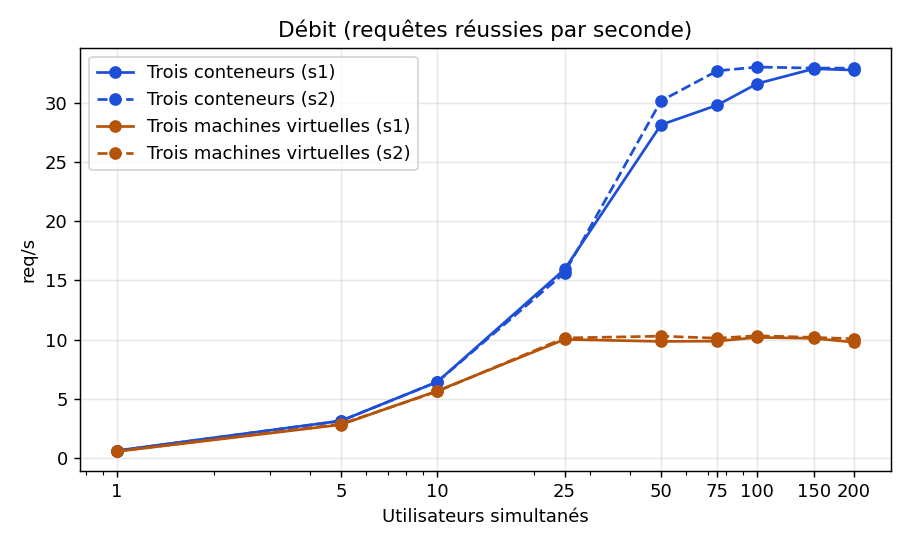
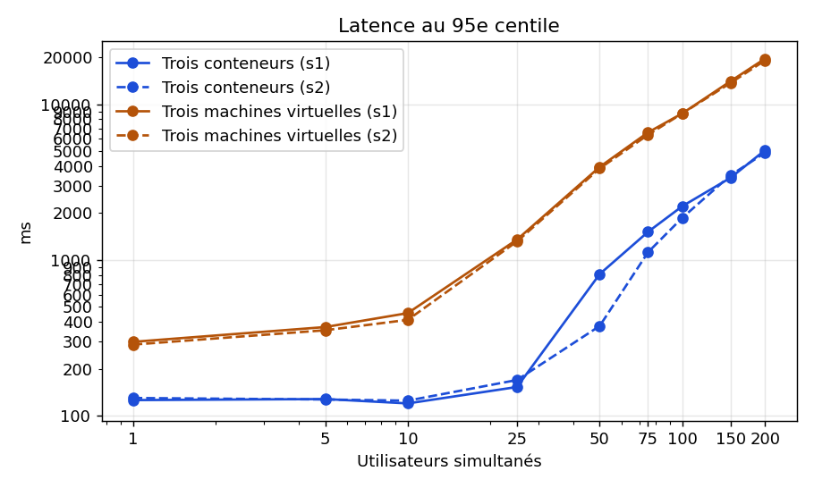

# Injection de charge — trois machines virtuelles face à trois conteneurs

*Planizi — DEV 1, étapes 15 à 18. Données brutes : `charge/resultats/`. Tableaux complets : `docs/charge-mesures.md` (générés par `charge/analyse.py`).*

## 1. Protocole

**Scénario.** Chaque utilisateur virtuel prend un compte dans `comptes.csv` (24 comptes `charge.*`), se connecte (`POST /connexion`), puis ouvre « Mon planning » (`GET /planning`). C'est le seul parcours qui traverse les trois couches. Chaque requête est précédée d'un temps de réflexion aléatoire de 1 à 2 s. Des assertions vérifient le code de retour (302 puis 200), le cookie de session, la redirection vers `/planning` et la présence d'au moins un shift dans la page. Le « test du test », avec un mot de passe faux, fait bien échouer les deux requêtes.

**Profil.** Neuf paliers, de 1 à 200 utilisateurs (1, 5, 10, 25, 50, 75, 100, 150, 200). Chaque palier comporte 30 s de montée, exclues de la mesure, puis 90 s de plateau mesuré. JMeter 5.6.3 tourne en ligne de commande sur l'hôte.

**Étalonnage.** Sur une ressource statique, l'injecteur atteint au moins 4 260 req/s sans erreur, contre 33 req/s au plus pour l'application, soit une marge de plus de 100 fois. Pendant les campagnes, JMeter n'a jamais dépassé 6 % d'un cœur. L'injecteur n'est donc pas le facteur limitant.

**Conditions identiques.** Même poste (i7-1260P, 16 cœurs logiques, 15,7 Gio, Windows 11), même jeu de comptes, même plan de test. Un seul déploiement tourne à la fois. Les deux séries alternent l'ordre : s1 = conteneurs puis VM, s2 = VM puis conteneurs. Les ressources sont alignées :

| | vm-proxy / proxy | vm-metier / metier | vm-donnees / donnees |
|---|---|---|---|
| Machines virtuelles | 1 vCPU, 1 Go | 2 vCPU, 2 Go, gunicorn 2 workers | 2 vCPU, 2 Go, PostgreSQL 18.6 |
| Conteneurs | `cpus: 1`, `mem_limit: 1g` | `cpus: 2`, `mem_limit: 2g`, gunicorn 2 workers | `cpus: 2`, `mem_limit: 2g`, PostgreSQL 16.9 |

**Répétabilité.** Entre s1 et s2, le débit diffère d'au plus **4,5 %** sur les VM et **9,7 %** sur les conteneurs, sous le seuil de 10 %. La latence varie davantage au voisinage immédiat de la saturation des conteneurs, de 16 à 54 % entre 50 et 100 utilisateurs, puis redevient stable à moins de 4 % au-delà. C'est attendu : au coude de la courbe, une petite variation de débit allonge fortement la file d'attente.

## 2. Résultats

| Grandeur | Trois machines virtuelles | Trois conteneurs | Écart |
|---|---|---|---|
| Débit maximal soutenu | **10,2 req/s** (s2 : 10,3) | **32,9 req/s** (s2 : 33,0) | × 3,2 |
| Charge au point de saturation | **entre 10 et 25** utilisateurs | **entre 25 et 50** utilisateurs | × 2 environ |
| Latence p95 à 10 utilisateurs (aucun des deux saturé) | 456 ms | 120 ms | × 3,8 |
| Latence p95 à 25 utilisateurs (charge égale) | 1 353 ms | 153 ms | × 8,8 |
| Latence p95 à 200 utilisateurs | 19,6 s | 5,1 s | × 3,9 |
| Taux d'erreur, tous paliers | 0 % | 0 % | — |
| Goulot d'étranglement | les 2 workers gunicorn, **bloqués en attente** | les 2 workers gunicorn, **limités par le processeur** | — |
| Temps de démarrage complet | 105 s (94 et 116 s ; 193 s avant correction réseau) | 5,9 s | × 18 |
| Mémoire consommée au repos | 2 362 Mio (5 120 Mio alloués) | 107 Mio (conteneurs) ; 858 Mio avec la VM du moteur | × 2,8 avec le moteur |

À faible charge, les deux déploiements suivent la charge offerte : 1 utilisateur produit environ 0,63 req/s, avec une efficacité de 100 %. Ensuite le débit plafonne, ce qui définit le point de saturation. Côté VM, le plafond est atteint dès 25 utilisateurs et reste plat jusqu'à 200, à 9,8–10,3 req/s. Côté conteneurs, il est atteint entre 50 et 75 utilisateurs et reste plat à 32,8–33,0 req/s. Au-delà, la latence croît linéairement avec le nombre d'utilisateurs, sans aucune erreur : les requêtes font la queue au lieu d'échouer.

## 3. Quelle propriété technique explique l'écart

**Le plafond est le même mécanisme des deux côtés : 2 workers synchrones.** Gunicorn lance 2 processus, et chacun traite une seule requête à la fois. Le débit maximal vaut donc *2 / temps d'occupation d'un worker par requête*. On en déduit ce temps à partir des débits mesurés :

| | VM | Conteneurs |
|---|---|---|
| Temps d'occupation d'un worker par requête (2 / débit max) | 2 / 10,2 = **196 ms** | 2 / 32,9 = **61 ms** |
| Processeur du service métier à saturation | 54 % d'un cœur | 175 % d'un cœur (limite : 200 %) |
| Temps processeur par requête (CPU / débit) | 0,54 / 10,2 = **53 ms** | 1,75 / 32,9 = **53 ms** |
| Part du temps worker passée à calculer | 27 % | 87 % |
| Temps worker passé **à attendre** | **≈ 143 ms** | ≈ 8 ms |

Le travail applicatif est **identique**, environ 53 ms de processeur par requête dans les deux cas. Ce coût est dominé par le hachage scrypt du mot de passe à la connexion. Toute la différence vient du **temps d'attente** : dans les VM, chaque requête immobilise un worker environ 143 ms sans rien calculer. Les mesures à faible charge le confirment de façon indépendante. À 10 utilisateurs, la médiane de la connexion passe de 111 ms (conteneurs) à 261 ms (VM), et celle du planning de 42 à 198 ms. C'est le même surcoût d'environ 150 ms, que la requête calcule beaucoup (connexion) ou presque rien (planning). Il s'agit donc d'un temps de **transit**, pas de calcul.

**D'où vient cette attente ?** Elle vient du trajet réseau, qui est **émulé** dans un cas et **partagé** dans l'autre.

- **En VM**, une requête traverse trois machines. Elle passe d'abord par le NAT de VirtualBox, de l'hôte vers vm-proxy : c'est un moteur réseau exécuté en espace utilisateur par l'hyperviseur. Elle emprunte ensuite le réseau interne de VirtualBox jusqu'à vm-metier, puis jusqu'à vm-donnees. L'application ouvre une nouvelle connexion PostgreSQL à chaque requête SQL, et le planning en ouvre plusieurs. Chaque paquet traverse la carte réseau virtuelle d'un système invité, l'hyperviseur, puis la carte virtuelle d'un autre système invité, avec des interruptions émulées à chaque bout.
- **En conteneurs**, les trois processus partagent le **même noyau**. Ils communiquent par des interfaces virtuelles reliées à un pont du noyau : un paquet passe d'un espace de nommage réseau à l'autre sans quitter le noyau, et sans transition vers un hyperviseur.

Une mesure indépendante situe cette attente : `GET /connexion`, qui affiche le formulaire sans toucher à la base ni au hachage, répond en **234 ms** sur les VM contre **7,6 ms** en conteneurs (`docs/comparaison.md`). L'attente se trouve donc **en amont du code applicatif**, sur le trajet NAT → proxy → métier, et non dans les connexions à la base. Ce test ouvre une nouvelle connexion TCP à chaque requête, ce qui explique qu'il perde un peu plus (227 ms) que les requêtes de JMeter, qui réutilisent leurs connexions (environ 150 ms).

**Pourquoi le processeur des VM reste bas alors que le service est saturé ?** Un worker synchrone qui attend une réponse réseau ne consomme pas de processeur, mais il ne peut pas non plus prendre une autre requête. Le goulot n'est donc pas une ressource matérielle épuisée. C'est la **concurrence** du serveur applicatif, 2 requêtes simultanées, multipliée par la **latence** de chaque requête. La loi de Little le résume : débit = concurrence / temps de séjour.

**Le contre-exemple qui valide le raisonnement.** Une première campagne de conteneurs avait été lancée avant l'alignement, avec 3 workers et sans limite de processeur. Elle plafonnait à **46 req/s** au lieu de 33. Le seul réglage du nombre de workers changeait donc le résultat de 40 %, comme le prédit la formule ci-dessus. Ces mesures sont conservées dans `charge/resultats/avant-alignement-3workers/`. C'est l'illustration directe de l'avertissement du sujet : un grand écart doit d'abord faire vérifier les réglages.

## 4. Quel composant cède en premier

| | Proxy | Métier | Données |
|---|---|---|---|
| VM à saturation | 20 % d'un cœur | 54 % d'un cœur, **2/2 workers occupés** | 36 % d'un cœur |
| Conteneurs à saturation | 1 à 4 % | **175 % sur 200 % autorisés** | 32 à 36 %, 1 connexion au plus |

- **Dans les deux cas, c'est le service métier qui cède**, plus précisément son pool de 2 workers gunicorn synchrones. Ni le proxy ni la base ne sont proches de leur limite.
- **En conteneurs**, la limite est le **processeur** alloué au métier (`cpus: 2`, appliqué par les groupes de contrôle). Le métier atteint 175 % pour une limite de 200 %, et le reste correspond aux attentes résiduelles. Pour aller plus loin, il faudrait plus de processeur ou un hachage moins coûteux.
- **En VM**, la limite est la **latence du chemin réseau virtualisé**. Les workers passent les trois quarts de leur temps à attendre. Ajouter des vCPU n'y changerait presque rien. Ajouter des workers, ou utiliser un serveur asynchrone, relèverait le plafond jusqu'à ce que le processeur devienne à son tour limitant.

On observe aussi un coût fixe de l'isolation par VM, visible côté hôte dès 1 utilisateur. Les trois VM au repos font tourner le processeur de l'hôte à environ 230 % d'un cœur, contre environ 115 % pour les conteneurs. Les trois systèmes invités consomment donc environ un cœur de plus avant même toute charge.

## 5. Ce que cette mesure ne dit pas

- **Rien sur la production.** Toutes les mesures portent sur un seul poste portable. Le jeu de données est minuscule : 39 comptes, environ 400 shifts. Le scénario se limite à deux requêtes en lecture seule, sans écriture, sans HTTPS et sans cache. Le comportement sur plusieurs machines physiques, en cas de panne ou sous une charge mixte n'a pas été testé.
- **Les conteneurs tournent eux aussi dans une VM.** Sous Windows, Docker Desktop exécute le moteur dans une machine virtuelle Linux (WSL 2). La comparaison oppose donc « 3 VM VirtualBox » à « 3 conteneurs dans une VM Hyper-V », pas des conteneurs sur Linux natif, où l'écart serait probablement plus grand encore.
- **Les deux déploiements ne sont pas identiques en tout.**
  - Versions : PostgreSQL 18.6 contre 16.9, Ubuntu contre images Debian.
  - Accès depuis l'hôte : NAT VirtualBox contre redirection de port de Docker Desktop.
  - Données : base `planning` contre `planizi`. Les comptes de test ont été recréés à la main dans la VM, avec uniquement des shifts « Travail ».

  Aucun de ces écarts ne touche le service qui sature, mais ils ne sont pas nuls.
- **Le temps d'attente n'est localisé qu'en partie.** On sait qu'il précède le code applicatif, puisque la page sans base perd 227 ms. On ne l'a pas réparti entre le NAT de VirtualBox et le saut proxy → métier : il faudrait mesurer un fichier statique servi par le proxy seul, et le métier interrogé directement depuis vm-proxy. Les relevés internes aux VM (E/S disque, connexions à la base) n'ont pas été collectés. Le processeur des VM est vu depuis l'hôte, à travers le processus VirtualBox.
- **La conclusion dépend du serveur applicatif.** Avec des workers asynchrones ou plus nombreux, l'attente réseau des VM ne bloquerait plus le débit de la même façon : l'écart se réduirait et le goulot passerait au processeur des deux côtés.

## 6. Conclusion

À ressources égales (2 vCPU, 2 Go et 2 workers pour le métier), le déploiement en conteneurs soutient **3,2 fois plus de débit**, environ 33 contre 10 req/s, et sature deux fois plus tard. Sa latence à faible charge est 2,4 à 4,7 fois plus basse. L'application fait pourtant le même travail des deux côtés : 53 ms de processeur par requête. L'écart vient d'environ **150 ms d'attente par requête** dans le chemin réseau virtualisé entre trois systèmes invités. Avec seulement 2 workers synchrones, cette attente se transforme directement en plafond de débit.

Les conteneurs paient cette performance par une frontière d'isolation plus mince, puisque le noyau est partagé. Le résultat mesuré ici est surtout la conséquence d'une architecture applicative sensible à la latence : c'est la combinaison de la technique d'isolation et du modèle de concurrence de gunicorn qui produit l'écart, pas la seule technique d'isolation.
